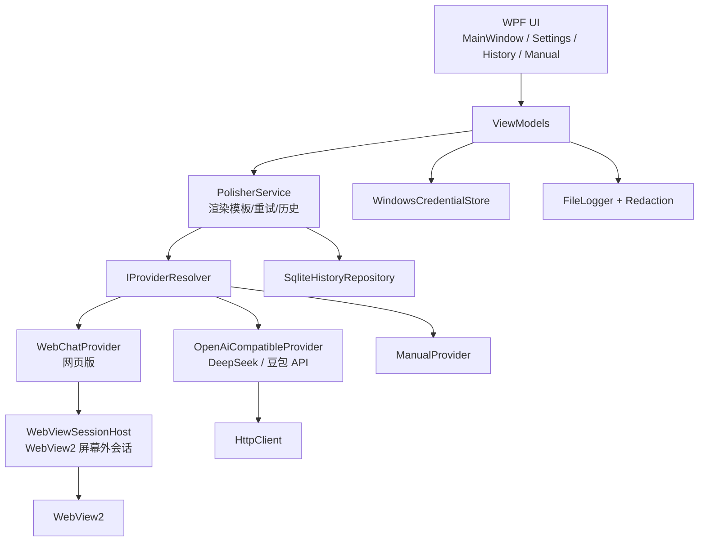

# Prompt 润色工具（Prompt Polisher）

一个 Windows 桌面应用：粘贴原始 Prompt，选择模型提供方与润色参数，应用在后台调用模型并把润色结果返回界面。**不弹出外部浏览器窗口**；支持官方 API、实验性网页版会话、以及最合规的手动模式。

> 当前版本：**v1.0.0** ｜ 仓库：<https://github.com/Clololo/PromptPolisher> ｜ Release 提供 self-contained 单文件 exe

> **默认免费网页版：** 应用默认使用 DeepSeek 网页版（可在设置切换豆包网页版）。首次需手动登录；遇到验证码/风控会停止，不会绕过。若平台限制自动化，可切换“手动模式”，或启用官方 API（可选备用）。详见 [docs/COMPLIANCE.md](docs/COMPLIANCE.md)。

---

## 0. 需求拆解与关键风险

### 0.1 需求拆解

| 需求 | 实现方式 |
|---|---|
| 输入 Prompt、参数化润色 | WPF 主界面 + 9 个参数 → 模板渲染 |
| 多提供方 | `IPolisherProvider` 抽象 + `ProviderFactory` |
| 后台调用、不弹外部浏览器 | 内嵌 WebView2（默认）+ 官方 API（可选） |
| 登录/会话复用 | WebView2 共享 user data folder；手动登录 |
| 凭据安全 | Credential Manager / DPAPI；不写配置/日志 |
| 历史 | SQLite（时间/提供方/模型/参数/原文/结果/状态） |
| 错误提示 | 统一错误码 + 用户可读提示 |
| 可扩展 | 新增 `ProviderDescriptor` / 实现接口 |
| 合规 | 官方 API/手动模式优先；网页版显式确认、验证码即停 |

### 0.2 关键风险

1. **网页版自动化合规风险（最高）**：可能违反平台服务条款；本应用不绕过验证码/风控/付费墙；若平台限制，请改用手动模式或官方 API。详见 [docs/COMPLIANCE.md](docs/COMPLIANCE.md)。
2. **网页 DOM 不稳定**：选择器随页面改版失效；已做成配置项，但仍属实验性。
3. **API Key 泄露**：只进 Credential Manager/DPAPI；设置页不回显；日志脱敏。
4. **Prompt 隐私**：历史默认存正文，可在设置关闭；日志从不记录正文。
5. **限流/成本**：429 映射为 `RATE_LIMITED`；重试有上限；建议设置预算。
6. **模型输出不稳定**：空结果/格式漂移映射为明确错误；模板要求“信息不足用 [待补充]”。

---

## 1. 功能

- 多行 Prompt 输入、流式输出、结果复制/导出、原文/结果对比；
- 润色参数：强度、风格、语言、长度、保留术语、原意、输出格式、额外要求、超时、重试、流式；
- 提供方抽象：**DeepSeek/豆包网页版（默认，免费）**、手动模式、官方 API（可选备用）；
- 系统 Prompt 模板可编辑，支持 `{{user_prompt}}` 等 9 个占位符，可恢复内置默认；**编辑结果保存到用户目录，重启和升级后仍生效**；
- 登录会话：WebView2 内嵌登录，会话复用；不保存明文密码；
- API Key：Windows Credential Manager（失败时 DPAPI 加密文件），不写配置/日志；
- 历史：SQLite，支持搜索/删除/清空；可关闭正文存储；
- 错误处理：超时、限流、登录失效、验证码、网络错误、空结果、选择器失效；
- 日志脱敏：不记录完整 Prompt、Key、Cookie、Token。

---

## 2. 技术栈

- .NET 8 + WPF（`net8.0-windows`）
- WebView2（Microsoft.Web.WebView2）
- CommunityToolkit.Mvvm
- Microsoft.Data.Sqlite
- Windows Credential Manager P/Invoke + DPAPI fallback
- xUnit

---

## 3. 快速开始

### 3.1 环境

- Windows 10/11
- .NET 8 SDK（开发）或 .NET 8 Desktop Runtime（运行）
- WebView2 Runtime（Windows 10/11 通常已随 Edge 安装）

检查：

```powershell
dotnet --info
```

### 3.2 运行

```powershell
cd C:\Users\KC\Desktop\PromptPolisher
dotnet run --project src\PromptPolisher.App
```

首次启动会在 `%LocalAppData%\PromptPolisher\` 创建：

```text
settings.json        # 非敏感设置
system-prompt.txt    # 用户系统 Prompt 模板（可编辑，重启后保留）
history.db           # SQLite 历史
logs\                # 脱敏日志
secrets\             # 仅 DPAPI 兜底时使用
webview\             # WebView2 会话数据
```

### 3.3 可选：配置 DeepSeek API（网页版被限制时）

1. 打开应用 → 右上角“设置” → “模型提供方”；
2. 选择 `DeepSeek（官方 API）`；
3. 在“API Key”输入框粘贴密钥 → “保存密钥”；
4. 点击“保存”；
5. 回到主界面，输入 Prompt → “润色”。

### 3.4 配置豆包 / 火山方舟 API

1. 在火山方舟控制台创建推理接入点，拿到 Endpoint ID；
2. 设置 → 选择 `豆包 / 火山方舟（官方 API）`；
3. 把 Endpoint ID 填到“模型 / Endpoint ID”；
4. 填入 API Key 并保存。

### 3.5 免费网页版（默认）

1. 选择 `DeepSeek 网页版（实验性）` 或 `豆包网页版（实验性）`；
2. 首次点击“润色”会提示合规确认；确认后如未登录，会提示登录；
3. 在应用内嵌的 WebView2 窗口手动完成登录（扫码/手机号）；
4. 点击“完成登录”，应用会复用会话在后台发送；
5. 若遇到验证码/安全验证，应用会停止并提示改用官方 API/手动模式。

> **注意：** 网页版 DOM 会变化，选择器可能失效；这是实验性功能，不保证长期可用。生产请用官方 API 或手动模式。

### 3.6 手动模式（最合规）

1. 选择 `手动模式（最合规）`；
2. 点击“润色”，应用生成最终 Prompt；
3. 复制到任意网页版，拿到结果后粘贴回应用；
4. 点击“使用此结果”，结果会进入输出区与历史。

---

## 4. 总体架构



**分层：**

| 层 | 职责 | 位置 |
|---|---|---|
| UI 层 | 输入/输出/参数/设置/历史/手动结果 | `src/PromptPolisher.App` |
| 润色服务层 | 模板渲染、重试、结果映射、历史写入 | `Core/Services` |
| 提供方适配层 | OpenAI 兼容 API、网页版、手动 | `Core/Providers` |
| 会话/凭据层 | WebView2 会话、Credential Manager/DPAPI | `App/Services` + `Core/Security` |
| 配置/历史层 | settings.json、system-prompt.txt、SQLite | `Core/Storage` + `Core/Services` |

详细设计见 [docs/ARCHITECTURE.md](docs/ARCHITECTURE.md)。

---

## 5. 目录结构

```text
PromptPolisher/
├─ PromptPolisher.sln
├─ config/
│  ├─ providers.example.json
│  ├─ appsettings.example.json
│  └─ system-prompt.default.txt
├─ docs/
│  ├─ ARCHITECTURE.md
│  ├─ COMPLIANCE.md
│  └─ ACCEPTANCE.md
├─ tools/
│  └─ mock_openai_server.py   # 本地验收用 OpenAI 兼容 Mock
├─ src/
│  ├─ PromptPolisher.Core/
│  │  ├─ Models/            # 请求/结果/提供方/历史/设置/错误码
│  │  ├─ Abstractions/      # IPolisherProvider、ICredentialStore 等接口
│  │  ├─ Services/          # 模板渲染、编排、日志、配置、工厂
│  │  ├─ Providers/         # OpenAI 兼容、网页版、手动
│  │  ├─ Storage/           # SQLite 历史
│  │  └─ Security/          # Credential Manager、DPAPI、脱敏
│  └─ PromptPolisher.App/
│     ├─ Views/             # Settings/History/Manual/WebViewHost
│     ├─ ViewModels/        # Main/Settings/History
│     ├─ Services/          # Bootstrapper/Dialog/ProviderCatalog/WebViewSessionHost
│     ├─ App.xaml(.cs)
│     └─ MainWindow.xaml(.cs)
└─ tests/
   └─ PromptPolisher.Tests/ # 40 个单元/集成测试
```

---

## 6. 核心接口

```csharp
public interface IPolisherProvider
{
    ProviderDescriptor Descriptor { get; }
    bool RequiresApiKey { get; }
    Task<PolisherResult> PolishAsync(
        PolisherRequest request,
        string renderedSystemPrompt,
        IProgress<string>? progress,
        CancellationToken cancellationToken);
}

public interface ICredentialStore
{
    Task<string?> GetSecretAsync(string key, CancellationToken ct = default);
    Task SetSecretAsync(string key, string value, CancellationToken ct = default);
    Task DeleteSecretAsync(string key, CancellationToken ct = default);
}

public interface IHistoryRepository
{
    Task InitializeAsync(CancellationToken ct = default);
    Task<long> AddAsync(HistoryEntry entry, CancellationToken ct = default);
    Task<IReadOnlyList<HistoryEntry>> SearchAsync(string? query, int limit = 100, CancellationToken ct = default);
    Task DeleteAsync(long id, CancellationToken ct = default);
    Task ClearAsync(CancellationToken ct = default);
}

public interface IWebSessionHost
{
    Task<WebSessionStatus> GetStatusAsync(string providerId, CancellationToken ct);
    Task<PolisherResult> SendAsync(string providerId, string renderedPrompt, int timeoutSeconds,
        IProgress<string>? progress, CancellationToken ct);
    Task<bool> ShowLoginAsync(string providerId, CancellationToken ct);
}
```

数据结构见 `src/PromptPolisher.Core/Models/`。

### 6.1 关键代码位置

| 需求 | 文件 |
|---|---|
| 主界面 / 参数 / 对比视图 | `src/PromptPolisher.App/MainWindow.xaml(.cs)` |
| 设置 / API Key / 模板编辑 | `src/PromptPolisher.App/Views/SettingsWindow.xaml(.cs)` |
| 历史搜索/删除/清空 | `src/PromptPolisher.App/Views/HistoryWindow.xaml(.cs)` |
| 手动模式结果粘贴 | `src/PromptPolisher.App/Views/ManualResultWindow.xaml(.cs)` |
| 内嵌 WebView2 登录/后台会话 | `src/PromptPolisher.App/Services/WebViewSessionHost.cs` + `Views/WebViewHostWindow.xaml(.cs)` |
| OpenAI 兼容 API（流式/非流式） | `src/PromptPolisher.Core/Providers/OpenAiCompatibleProvider.cs` |
| 网页版适配器 | `src/PromptPolisher.Core/Providers/WebChatProvider.cs` |
| 模板渲染/校验 | `src/PromptPolisher.Core/Services/PromptTemplateRenderer.cs` |
| 编排/重试/历史写入 | `src/PromptPolisher.Core/Services/PolisherService.cs` |
| 凭据安全存储 | `src/PromptPolisher.Core/Security/WindowsCredentialStore.cs` |
| 日志脱敏 | `src/PromptPolisher.Core/Security/Redaction.cs` |
| SQLite 历史 | `src/PromptPolisher.Core/Storage/SqliteHistoryRepository.cs` |
| 错误码/提示 | `src/PromptPolisher.Core/Models/ErrorCodes.cs` |

---

## 7. 系统 Prompt 模板

默认模板：`config/system-prompt.default.txt`（随程序发布的内置默认模板）。

- **用户模板**：设置页编辑后保存到 `%LocalAppData%\PromptPolisher\system-prompt.txt`。
- **加载优先级**：旧配置内嵌模板 > 用户模板文件 > 程序内置默认模板 > 代码常量。
- **持久化**：修改后重启不会丢失；程序升级也不会覆盖用户模板。
- **恢复默认**：设置页“恢复默认”读取程序目录的 `config/system-prompt.default.txt`（文件缺失时回退到代码内置常量），点击“保存”后生效。

占位符：

| 占位符 | 含义 |
|---|---|
| `{{user_prompt}}` | 原始 Prompt（必须存在） |
| `{{strength}}` | 轻度/标准/深度 |
| `{{style}}` | 通用/严谨/简洁/创意/技术文档/营销/学术 |
| `{{language}}` | 保持原文/中文/英文/其他 |
| `{{length}}` | 缩短/保持/适度扩写 |
| `{{preserve_terms}}` | 必须保留的术语 |
| `{{format}}` | 仅结果/结果+说明/Markdown |
| `{{preserve_meaning}}` | 是否保留原意 |
| `{{extra_instructions}}` | 额外要求 |

修改参数会实际改变发送给模型的 system prompt（单元测试覆盖）。

---

## 8. 错误码

| 错误码 | 含义 | 处理 |
|---|---|---|
| `AUTH_REQUIRED` | API Key 未配置/失效，或网页未登录 | 设置中填 Key / 重新登录 |
| `RATE_LIMITED` | 429 限流 | 稍后重试 |
| `TIMEOUT` | 请求超时 | 调大超时/检查网络 |
| `NETWORK_ERROR` | 网络失败 | 检查代理/防火墙 |
| `PROVIDER_ERROR` | 5xx/其他服务错误 | 稍后重试 |
| `EMPTY_RESULT` | 空结果 | 重试/换模型 |
| `CAPTCHA_REQUIRED` | 检测到验证码/风控 | 手动完成或改用 API/手动模式 |
| `COMPLIANCE_CONSENT_REQUIRED` | 未确认网页版合规声明 | 勾选确认 |
| `WEB_SELECTOR_NOT_FOUND` | 网页结构变化 | 更新选择器/改用 API |
| `WEB_AUTOMATION_FAILED` | 网页自动化失败 | 重试/改用 API |
| `CONFIG_ERROR` | 配置/模板不完整 | 检查设置/模板 |
| `CANCELLED` | 用户取消 | — |

完整映射见 `Core/Models/ErrorCodes.cs`。

---

## 9. 测试

```powershell
dotnet test PromptPolisher.sln
```

覆盖：

- 模板渲染/校验（9 个占位符、未知占位符、缺少 user_prompt）；
- 日志脱敏（API Key、Bearer、Cookie、password）；
- SQLite 历史增删查清；
- OpenAI 兼容 Provider 的成功/401/429/空结果/缺 Key/流式解析；
- 编排重试、无效请求、手动模式不写历史、关闭历史；
- 网页版合规确认、未登录、委托发送；
- 配置保存/加载与“不写 API Key”。

当前结果：**40 passed**。

---

## 10. 打包

**推荐：自包含单文件（Release 发布形态，免装 .NET）**

```powershell
dotnet publish src\PromptPolisher.App\PromptPolisher.App.csproj `
  -c Release -r win-x64 --self-contained true `
  -p:PublishSingleFile=true `
  -p:IncludeNativeLibrariesForSelfExtract=true `
  -o publish\self-contained
```

发布目录内保留 `config\`（内置默认模板与示例配置），与 exe 一起分发。WebView2 Runtime 仍需系统安装（Windows 10/11 通常自带）。

**可选：框架依赖（体积小，需要 .NET 8 Desktop Runtime）**

```powershell
dotnet publish src\PromptPolisher.App\PromptPolisher.App.csproj `
  -c Release -r win-x64 --self-contained false `
  -o publish\framework-dependent
```

运行 `publish\...\PromptPolisher.App.exe`。

---

## 11. 验收

对照 `prompt.txt` 的验收标准：

| 验收项 | 实现 |
|---|---|
| 输入后后台调用并返回结果 | ✅ 官方 API / 网页版 / 手动模式 |
| 参数改变会改变系统 Prompt | ✅ 模板渲染 + 单测 |
| 首次登录保存会话，后续复用 | ✅ WebView2 共享 user data folder |
| 会话失效有提示 | ✅ `AUTH_REQUIRED` + 登录入口 |
| 不弹出外部浏览器 | ✅ 内嵌 WebView2 / 屏幕外窗口 |
| 密码/Cookie/Token 不明文 | ✅ Credential Manager/DPAPI + WebView2 加密存储 |
| 复制结果/查看历史 | ✅ |
| 网络/超时/登录失效/空结果提示 | ✅ 错误码 |
| 说明网页自动化合规边界 | ✅ 本 README + docs/COMPLIANCE.md |
| 不可行时给 API/手动替代 | ✅ 官方 API + 手动模式 |

详细手工测试用例见 [docs/ACCEPTANCE.md](docs/ACCEPTANCE.md)。

---

## 12. 已知限制

- **网页版适配器是实验性的**：DeepSeek/豆包页面结构随时可能变化，选择器可能失效；不做验证码绕过/风控规避。
- **网页版自动化可能违反平台条款**：是否可用取决于平台政策与你的账号权限；生产建议官方 API。
- **豆包 API 需要 Endpoint ID**：不是模型名；请在火山方舟控制台创建接入点。
- **历史默认明文存 SQLite**：位于用户 LocalAppData；可在设置中关闭 Prompt 正文存储。日志始终不记录正文。
- **单用户桌面应用**：没有多租户/服务端部署能力。
- **未做代码签名**：分发时 Windows SmartScreen 可能提示。

---

## 13. 免责声明

本工具仅用于辅助 Prompt 编写。使用者应自行确认所用模型服务的条款、计费、数据合规与账号权限。网页版自动化功能默认关闭合规确认；启用即表示你确认平台允许并自行承担风险。作者不对因违反平台条款、账号受限或数据泄露造成的损失负责。
