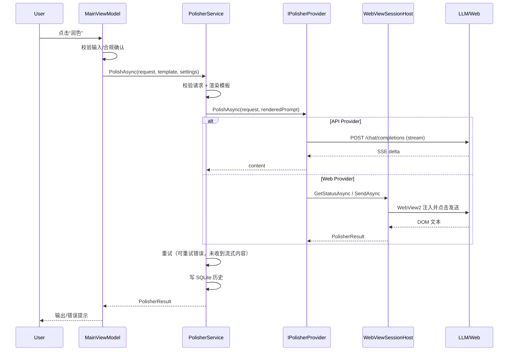

# 架构设计

## 1. 目标与非目标

**目标**

- 一个可运行的 Windows 桌面应用，输入 Prompt 后能在后台调用模型并返回润色结果；
- 官方 API、网页版会话、手动模式三种路径；
- 参数化系统 Prompt 模板；
- 凭据安全存储、日志脱敏、历史记录；
- 提供方可扩展。

**非目标**

- 不做多租户/SaaS/服务端部署；
- 不破解登录、不绕过验证码/风控/付费墙；
- 不保证网页版长期可用（DOM 会变）；
- 不做模型训练/微调。

## 2. 分层

```text
┌─────────────────────────────────────────────┐
│ UI (WPF)                                     │
│ MainWindow / Settings / History / Manual     │
└──────────────────────┬──────────────────────┘
                       │ Commands / Bindings
┌──────────────────────▼──────────────────────┐
│ ViewModels (CommunityToolkit.Mvvm)           │
│ MainViewModel / SettingsViewModel / History  │
└──────────────────────┬──────────────────────┘
                       │
┌──────────────────────▼──────────────────────┐
│ Application Services                         │
│ PolisherService / DialogService /            │
│ ProviderCatalog / WebViewSessionHost         │
└──────────────────────┬──────────────────────┘
                       │
┌──────────────────────▼──────────────────────┐
│ Core                                         │
│ IPolisherProvider / PromptTemplateRenderer   │
│ OpenAiCompatibleProvider / WebChatProvider   │
│ ManualProvider / SqliteHistoryRepository     │
│ WindowsCredentialStore / Redaction           │
└─────────────────────────────────────────────┘
```

依赖方向：UI → ViewModels → Services → Core。Core 不引用 WPF/WebView2（`IWebSessionHost` 是接口）。

## 3. 请求时序



## 4. 模块说明

| 模块 | 职责 | 关键文件 |
|---|---|---|
| `PromptTemplateRenderer` | 校验/渲染 9 个占位符 | `Core/Services/PromptTemplateRenderer.cs` |
| `PolisherService` | 校验、解析 Provider、重试、历史 | `Core/Services/PolisherService.cs` |
| `OpenAiCompatibleProvider` | OpenAI 兼容 API、SSE、错误映射 | `Core/Providers/OpenAiCompatibleProvider.cs` |
| `WebChatProvider` | 合规检查、登录检查、委托会话宿主 | `Core/Providers/WebChatProvider.cs` |
| `ManualProvider` | 返回渲染后的 Prompt，等待用户粘贴结果 | `Core/Providers/ManualProvider.cs` |
| `WebViewSessionHost` | WebView2 初始化、导航、DOM 注入、轮询、验证码检测 | `App/Services/WebViewSessionHost.cs` |
| `WindowsCredentialStore` | Credential Manager + DPAPI fallback | `Core/Security/WindowsCredentialStore.cs` |
| `Redaction` | 日志脱敏 | `Core/Security/Redaction.cs` |
| `SqliteHistoryRepository` | 历史表 CRUD | `Core/Storage/SqliteHistoryRepository.cs` |
| `JsonSettingsService` | 非敏感配置 + 模板文件 | `Core/Services/JsonSettingsService.cs` |
| `ProviderCatalog` | 根据设置动态创建 Provider | `App/Services/ProviderCatalog.cs` |
| `DialogService` | 设置/历史/手动结果/合规确认/登录 | `App/Services/DialogService.cs` |

## 5. 提供方抽象

```csharp
public interface IPolisherProvider
{
    ProviderDescriptor Descriptor { get; }
    bool RequiresApiKey { get; }
    Task<PolisherResult> PolishAsync(
        PolisherRequest request,
        string renderedSystemPrompt,
        IProgress<string>? progress,
        CancellationToken cancellationToken);
}
```

新增提供方：

1. 在 `AppSettings.CreateDefault().Providers` 加一条 `ProviderDescriptor`；
2. 如果是 OpenAI 兼容 API，直接 `Kind = Api`，填 `BaseUrl`/`Model`；
3. 如果需要新协议，实现 `IPolisherProvider`，在 `ProviderFactory` 注册；
4. 在设置页填入密钥/URL/模型；
5. 增加对应单元测试。

## 6. 模板与参数

- 模板语法 `{{name}}`；白名单 9 个占位符；
- 渲染前校验：未知占位符、缺少 `user_prompt` 都会失败；
- 参数到文本的映射集中在 `PromptTemplateRenderer`，便于测试和本地化；
- 模板文件：用户模板 `%LocalAppData%\PromptPolisher\system-prompt.txt`（设置页编辑，重启保留）；内置默认 `config\system-prompt.default.txt`（随程序发布，“恢复默认”读取，缺失时回退代码常量）；
- 加载优先级：旧配置内嵌模板 > 用户模板文件 > 内置默认模板 > 代码常量；
- 程序启动时若用户模板不存在，会把内置默认写入用户模板路径；之后不再用内置文件覆盖用户编辑。

## 7. 错误处理与重试

- Provider 返回 `PolisherResult`，不抛业务异常；
- HTTP 状态映射：401/403 → `AUTH_REQUIRED`；429 → `RATE_LIMITED`；5xx → `PROVIDER_ERROR`；
- 超时/网络 → `TIMEOUT` / `NETWORK_ERROR`；
- 空内容 → `EMPTY_RESULT`；
- 网页：验证码 → `CAPTCHA_REQUIRED`；选择器失效 → `WEB_SELECTOR_NOT_FOUND`；
- 重试仅针对 `TIMEOUT/NETWORK_ERROR/RATE_LIMITED/PROVIDER_ERROR/WEB_AUTOMATION_FAILED`，最多 5 次，指数退避；
- 如果流式已经收到部分内容，不重试，避免重复输出。

## 8. 会话与凭据

**API Key**

1. 优先 `CredWrite` 写入 Windows Credential Manager（Generic，LocalMachine）；
2. 失败则 DPAPI（CurrentUser）加密到 `%LocalAppData%\PromptPolisher\secrets\<sha256>.bin`；
3. 读取时先 Credential Manager，再 fallback；
4. 配置/日志/数据库都不存 Key。

**网页会话**

- WebView2 使用独立 user data folder：`%LocalAppData%\PromptPolisher\webview\shared`；
- Cookie/本地存储由 Chromium 加密管理；
- 登录时显示内嵌窗口；登录完成后窗口移到屏幕外继续运行；
- 应用不读取/导出 Cookie。

## 9. 网页自动化机制（实验性）

1. 导航到 `ChatUrl`；
2. 检测 URL/页面文本中的验证码/风控关键词；
3. 检测登录 URL/文本/已登录选择器；
4. 用 JS 找到输入框（textarea/contenteditable），设置值并派发 `input/change`；
5. 点击发送按钮（或 Enter fallback）；
6. 每 800ms 轮询响应节点数量/最后一条文本/是否仍在生成；
7. 文本稳定 2.5s 且不在生成 → 视为完成；
8. 超时 → `WEB_AUTOMATION_FAILED`。

选择器全部在 `providers.json`/默认配置中，页面改版时可更新；不保证长期可用。

## 10. 存储

`history.db`：

```sql
CREATE TABLE History (
    Id INTEGER PRIMARY KEY AUTOINCREMENT,
    CreatedAt TEXT NOT NULL,
    ProviderId TEXT NOT NULL,
    Model TEXT NOT NULL,
    ParametersJson TEXT NOT NULL,
    OriginalPrompt TEXT NOT NULL,
    PolishedPrompt TEXT NOT NULL,
    Status TEXT NOT NULL,
    ErrorCode TEXT NULL,
    DurationMs INTEGER NOT NULL
);
```

`settings.json` 只存非敏感设置；`system-prompt.txt` 存模板。

## 11. 线程模型

- UI 线程：WPF 绑定、WebView2 创建/导航；
- 网络：`HttpClient` 异步；
- 流式回调：`Progress<string>` 回到 UI 上下文追加文本；
- WebView2 操作必须在 UI 线程执行（调用链默认回到 UI 上下文）；
- 取消：`CancellationTokenSource` 贯穿 Provider/HTTP/轮询。

## 12. 安全边界

| 边界 | 措施 |
|---|---|
| API Key | Credential Manager/DPAPI，不落配置/日志 |
| 网页会话 | WebView2 加密 profile，不导出 Cookie |
| 日志 | `Redaction` 正则，默认不记录 Prompt 正文 |
| 历史 | LocalAppData SQLite；可关闭正文存储 |
| 执行 | 不执行模型返回的代码；网页只做 DOM 操作 |
| 合规 | 显式确认；验证码即停；不绕过风控 |

## 13. 已知风险

- 网页版 DOM 变化导致选择器失效；
- 平台条款/风控可能限制自动化；
- 豆包 Endpoint ID 配置错误会返回 4xx；
- 历史默认明文存储（可在设置关闭正文）；
- 未做代码签名，SmartScreen 可能提示。
